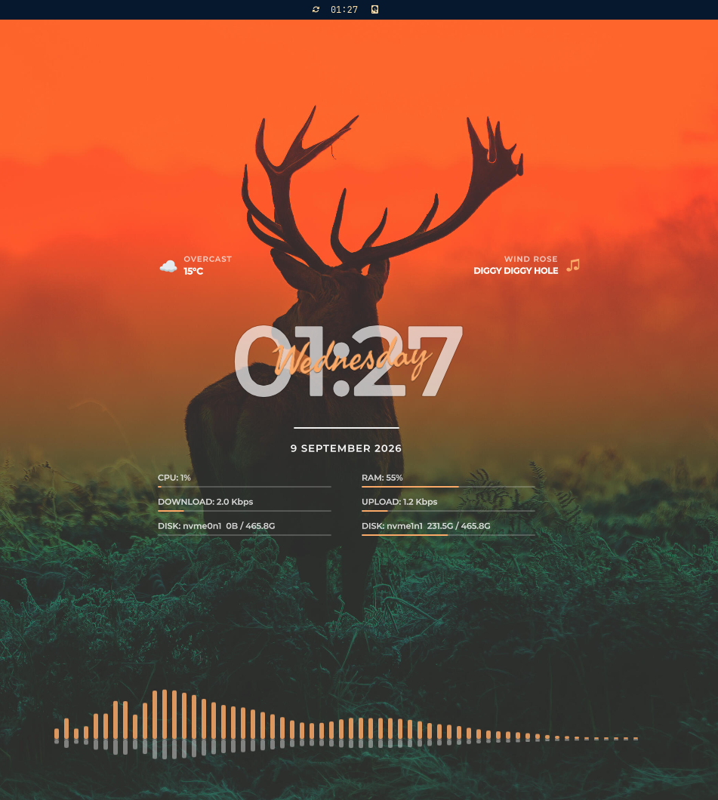

# Omark Meter

Robik-inspired desktop widget suite for Omarchy (Hyprland + Quickshell) — renders on the desktop **Background** layer as a `PanelWindow` per monitor.



## Features

*   **Hero Clock:** Translucent `HH:mm` (24h, minute-precision) using **Montserrat SemiBold 600** with script weekday overlay (**Freehand** OFL font) and `D MMMM YYYY` date.
*   **Weather Widget:** Top-left weather conditions and temperature with condition icons.
*   **Media Widget:** Top-right active media player ticker (powered by `dbus-python` MPRIS integration, compatible with Brave, YouTube Music, VLC, etc.).
*   **Dynamic System Metrics:** CPU, RAM, Network up/down throughput, and automatic universal physical disk detection (`nvme*`, `sd*`, `vd*`, etc.) displaying usage sizes and meters arranged in a clean grid.
*   **Live Audio Visualizer:** Bottom 60-band log-spaced FFT real-time audio visualizer streaming from PipeWire/PulseAudio sink monitors (`parec` + `numpy`).
*   **Theme Integration:** Fully follows your active theme's `Color.accent` live.
*   **Desktop Gestures:** Double-click background (left for theme background switcher, right for theme switcher).

## Install

```bash
# manual
mkdir -p ~/.config/omarchy/plugins/george.omarkmeter
cp -r assets *.qml *.py manifest.json ~/.config/omarchy/plugins/george.omarkmeter/
quickshell ipc -p /usr/share/omarchy/shell call shell rescanPlugins
# or via helper
omarchy plugin add https://github.com/Compourri/omarkmeter.git --enable --yes
```

## Layout Knobs

*   `RobikClock.qml`: `heroSize`, `scriptSize`, `heroOpacity`, `heroColor`, `dividerWidth`
*   `Clock.qml`: `offsetX/Y` offsets to shift off-center.

## Plugin Spec

*   `id: george.omarkmeter` — `name: Omark Meter` — `kinds: [service]` — `entryPoints.service: Clock.qml`
*   Fonts: `assets/Freehand-Regular.ttf` (OFL), `assets/Montserrat-SemiBold.otf` (OFL)

## License

MIT — see `LICENSE` (fonts have their own licenses).
